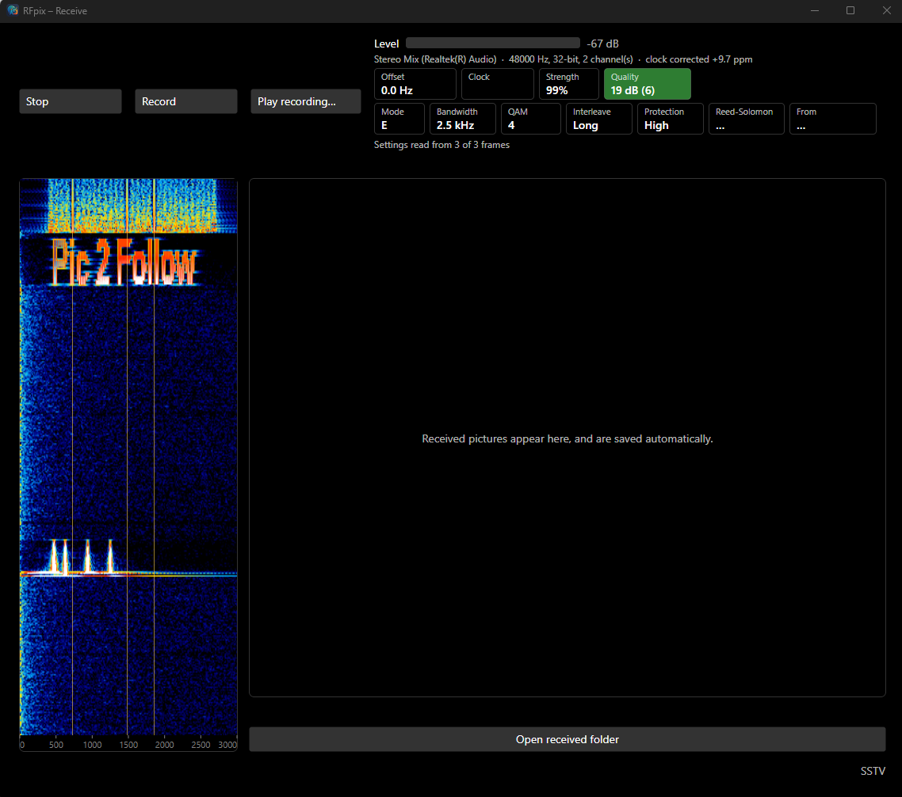
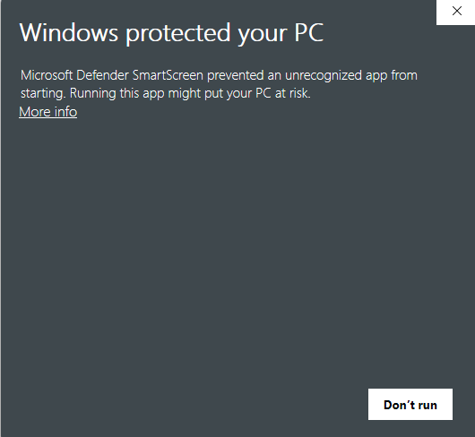
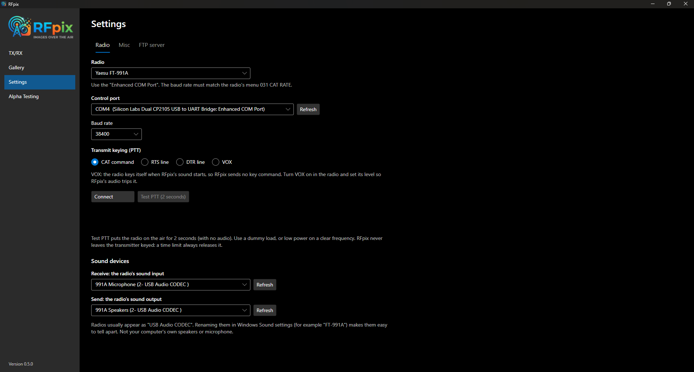
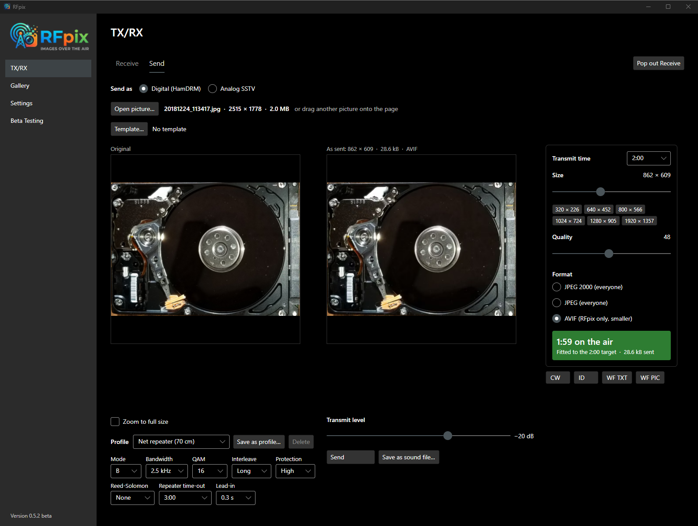
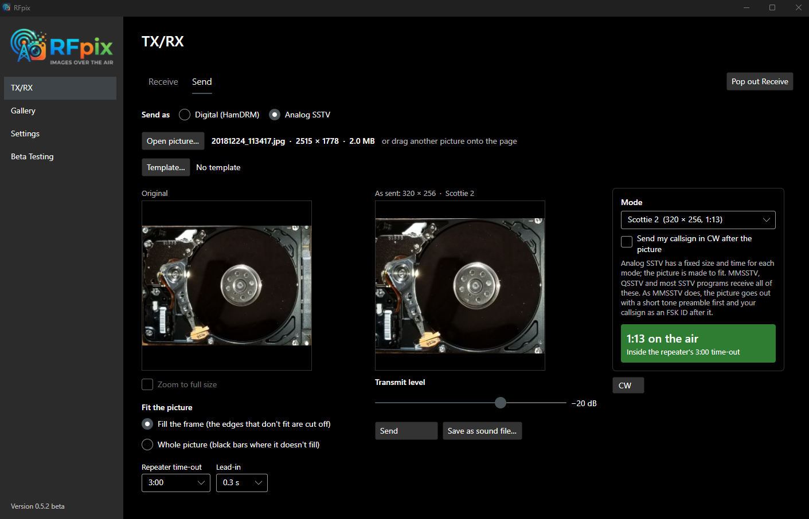
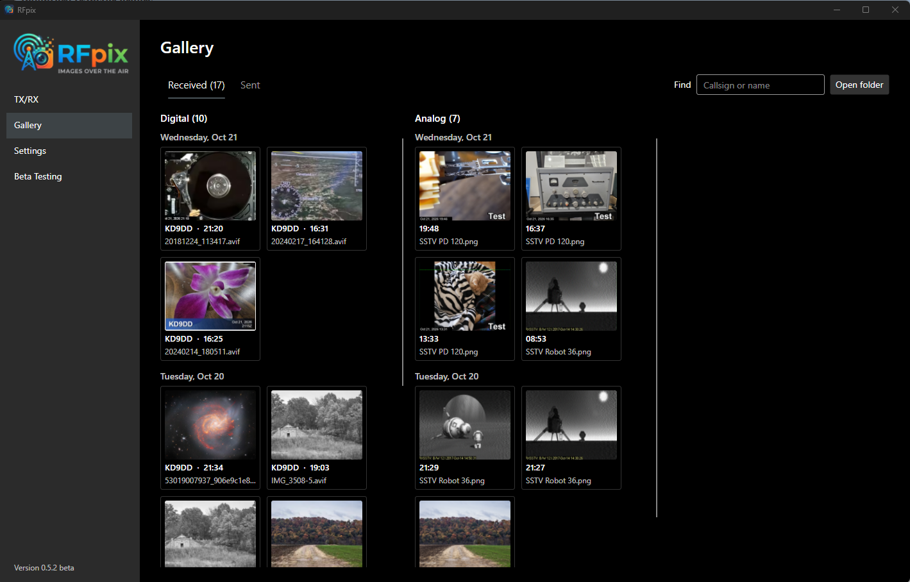
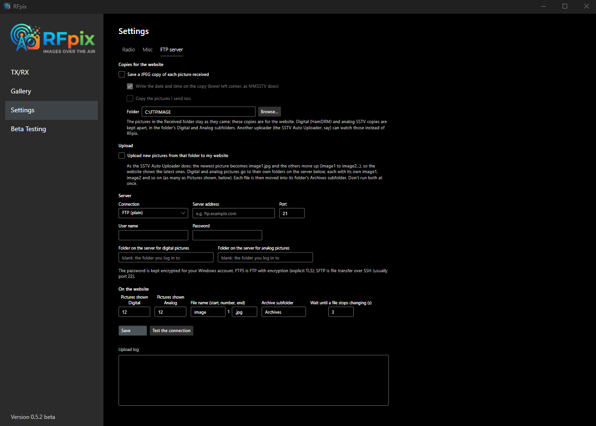

# RFpix User Manual

Version 0.5.2 beta · Oct 22, 2026 · KD9DD

This manual covers RFpix version 0.5.2 beta for Windows 10 and 11. If you're new to RFpix, read Part 1 and follow the setup checklist in section 3; it takes about 20 minutes and ends with your first picture received and sent.

The manual has three parts:

- **Part 1, Getting started:** what RFpix is, installing it, and setting it up.
- **Part 2, Using it:** receiving, sending digital and analog pictures, templates, the Gallery, and putting pictures on a website.
- **Part 3, Reference:** every setting, tab by tab; what RFpix's messages mean; and a glossary.

Words in **bold** are what you see on the screen: a page, tab, button or box. *\[Screenshot: …\]* marks where a picture of the screen will go.

## Part 1: Getting started

### 1. What RFpix is

RFpix sends and receives pictures by radio in two ways: **digital** (HamDRM, the same as EasyPal and QSSTV's digital mode) and **analog SSTV** (the same as MMSSTV and QSSTV's analog modes). It listens for both at once, so you don't have to say which is coming.

|  | Digital (HamDRM) | Analog SSTV |
| --- | --- | --- |
| Talks to | EasyPal, QSSTV (DRM), other RFpix stations | MMSSTV, QSSTV, most SSTV programs and apps |
| Sounds like | A steady hiss about 2.5 kHz wide | One warbling tone |
| The picture | Any size; arrives as an exact copy of the file sent | A fixed size for each mode; painted line by line |
| When the signal is weak | Pieces go missing; RFpix can ask for just those pieces again | Noise shows as speckles and streaks |
| Time on the air | You choose (RFpix fits the picture to it) | Set by the mode: 36 seconds to almost 5 minutes |

RFpix has four pages, chosen from the list on the left:

- **TX/RX:** the **Receive** tab (the waterfall, the signal, and the last picture received) and the **Send** tab (your picture, how it will go out, and the **Send** button).
- **Gallery:** every picture you've received and sent.
- **Settings:** your radio, sound devices, callsign, and website upload.
- **Beta Testing:** fixed test transmissions, for checking how well pictures get through.

A few things RFpix does for you:

- **Fits your picture to the time you choose.** Pick 1 minute, say, and RFpix works out the size and quality that just fit, and keeps you inside your repeater's time-out.
- **Repairs pictures.** When a digital picture arrives with pieces missing, one click asks the sender for just those pieces.
- **Saves everything.** Every picture received is saved on its own, and can be put on your website automatically.
- **Adds your callsign.** Templates draw your callsign, a CQ card or a reply on the picture as it goes out.

*The Receive tab, popped out into its own window, while a digital picture arrives: the waterfall on the left, the signal and settings boxes at the top, and the picture area on the right.*

### 2. Installing

RFpix is free to download from its [releases page on GitHub](https://github.com/brandandon/RFpix/releases/latest). It needs a 64-bit Windows 10 or 11 computer. Each release offers two files under **Assets**:

| File | What it is | Choose it if |
| --- | --- | --- |
| **RFpix-Setup-0.5.2-beta.exe** | An installer | You want RFpix in the Start menu and easy to update (recommended) |
| **RFpix.exe** | The program in one file, nothing to install | You want to run it from a folder or a USB stick |

#### Installing with the installer

1. Download **RFpix-Setup-0.5.2-beta.exe** and open it.
2. If Windows says *"Windows protected your PC"*, click **More info**, then **Run anyway**. Windows says this about new programs that aren't yet signed; it doesn't mean anything is wrong.
3. Accept the licence, and choose where to put RFpix. The suggested folder needs no administrator password.
4. Tick **Put a shortcut on the desktop** if you want one.
5. Click **Install**, then **Finish**. RFpix starts.

*Click **More info**: a **Run anyway** button appears beside **Don't run**.*

#### Running RFpix.exe without installing

Put **RFpix.exe** in any folder and double-click it. The first time each new version runs, it takes a few seconds longer while it unpacks its parts into a hidden folder. The *"Windows protected your PC"* message may appear here too; click **More info**, then **Run anyway**.

#### Updating

Download the newer installer and run it. It closes RFpix if it's running and replaces the old version. Your settings and pictures stay as they are.

#### Uninstalling

In Windows, open **Settings > Apps**, find **RFpix**, and choose **Uninstall**. RFpix asks whether to remove your settings too (radio, sound devices, callsign). Your pictures, recordings and test results in **Documents\RFpix** are always kept.

#### Where RFpix keeps things

| What | Where |
| --- | --- |
| Pictures received | Documents\RFpix\Received (in its Digital and Analog folders) |
| Pictures sent | Documents\RFpix\Sent |
| Recordings | Documents\RFpix\Recordings |
| Templates | Documents\RFpix\Templates |
| Test results | Documents\RFpix\Test results.csv |
| Settings | %AppData%\RFpix\settings.json |

### 3. First-time setup checklist

Work through these steps in order the first time you run RFpix. Everything is saved as you go, so you only do this once. You'll need the radio switched on and connected to the computer by its USB cable.

- [ ] **1. Enter your callsign and grid square.** Open **Settings**, then the **Misc** tab. Type your callsign in **Your callsign** (up to 9 characters; it goes out with every picture). Type your grid square in **Your grid square (QTH)**, 4 or 6 characters such as AA00 or AA00aa.
- [ ] **2. Pick your radio.** On the **Radio** tab, choose your radio from the **Radio** list. RFpix fills in the usual settings for it; the note under the list says what to check.
  - **Yaesu FT-991A:** choose the *Enhanced COM Port*. The baud rate must match the radio's menu 031 CAT RATE.
  - **Icom IC-9700:** choose the first of its two COM ports. Leave the CI-V address at A2 unless you've changed it in the radio.
  - **Another radio:** choose **Other radio**, then type part of its model (such as 7300) and pick it from the list.
  - **Another program already controls the radio:** choose **Shared through rigctld** or **Shared through flrig**.
  - **No cable for control:** choose **No radio control (VOX only)**, and turn VOX on in the radio.
- [ ] **3. Choose how the transmitter is keyed.** Under **Transmit keying (PTT)**, pick **CAT command**, **RTS line**, **DTR line** or **VOX**. CAT suits most radios; the IC-9700 works well with RTS. With an IC-9700, you can also tick **Switch the IC-9700 to data mode while transmitting**.
- [ ] **4. Connect and test the keying.** Click **Connect**: the radio's frequency appears. Then click **Test PTT (2 seconds)**. The radio transmits for 2 seconds with no audio, so use a dummy load, or low power on a clear frequency.
- [ ] **5. Pick the sound devices.** At the bottom of the **Radio** tab, under **Sound devices**, choose the radio's sound input and output. Radios usually show as *USB Audio CODEC*. Don't pick the computer's own speakers or microphone. Tip: rename the radio's devices in Windows' Sound settings (to *FT-991A*, say) to tell them apart.
- [ ] **6. Calibrate the sound card.** Back on the **Misc** tab, first check Windows' clock is right (Windows **Settings > Time & language > Date & time > Sync now**). Then click **Measure (2 minutes)** under **Sound-card calibration**. The radio stays receiving; RFpix doesn't key it. This corrects for a sound card that runs a little fast or slow, which would otherwise slant analog pictures and upset digital ones.
- [ ] **7. Receive something.** Open **TX/RX**, then the **Receive** tab, and click **Start listening**. The level bar should move with the band noise and stay out of orange; if it turns orange, turn down the radio's USB audio output. Tune to a frequency where pictures are being sent and wait: pictures appear on the right and are saved automatically.
- [ ] **8. Send your first picture.** Open the **Send** tab and click **Open picture…** (or drag a picture onto the tab). Choose **Digital (HamDRM)** or **Analog SSTV**, and set **Transmit time** or the analog mode. Then click **Send**.
- [ ] **9. Set the transmit level.** While sending, watch the radio's ALC meter and move the **Transmit level** slider until the ALC barely moves. The slider works during a transmission, and RFpix remembers where you leave it.

*Settings, Radio tab, set up for a Yaesu FT-991A: the Enhanced COM Port at 38400 baud, CAT keying, and the radio's USB sound devices at the bottom.*

When all nine boxes are ticked, RFpix is ready. Part 2 explains receiving and sending in detail.

## Part 2: Using it

### 4. Receiving

Open **TX/RX**, then the **Receive** tab, and click **Start listening**. RFpix listens for digital and analog pictures at the same time, and saves every picture it receives without being asked.

*A digital picture arriving: Mode E, 2.5 kHz, 4-QAM; quality 19 dB where 6 is needed, so the Quality box is green. The waterfall shows the sender's waterfall text ("Pic 2 Follow") above the picture's signal, with its three pilot lines on the marks.*

#### What's on the Receive tab

| Part | What it shows |
| --- | --- |
| **Start listening / Stop** | Starts and stops listening to the radio's sound input. |
| **Record** | Saves what the radio hears as a sound file, starting 30 seconds *before* you click it, so a picture that's already arriving is caught. Click **Stop recording** to finish. Recordings go to Documents\RFpix\Recordings. |
| **Play recording…** | Plays a saved recording into RFpix instead of the radio, for testing or for recordings other stations send you. |
| **Level** | How loud the radio's audio is. Keep it out of orange: orange means too loud, so turn the radio's USB audio output down. |
| **Signal boxes** | Offset, Clock, Strength and Quality of a digital signal (below). |
| **Settings boxes** | How a digital picture was sent: Mode, Bandwidth, QAM, Interleave, Protection, Reed-Solomon, and who it's From. |
| **Waterfall** (left) | The sound the radio hears, as a picture that scrolls down. Each signal shows as a coloured trace. |
| **Picture** (right) | The last picture received, with its name, who sent it, and where it was saved. |
| **Open received folder** | Opens the folder where pictures are saved. |

The boxes show only while a picture is arriving; the rest of the time their space is left empty.

#### The signal boxes (digital)

| Box | Meaning |
| --- | --- |
| **Offset** | How far the signal is from where it should be, in Hz. Small numbers are fine; RFpix follows the signal. |
| **Clock** | How fast or slow the sender's sound card runs, in parts per million (ppm). RFpix corrects for it. |
| **Strength** | How strong the signal is, as a percentage. |
| **Quality** | The signal's quality in dB, with the quality these settings need in brackets: **14 dB (11)** means 14 dB heard and 11 needed. The box is **green** when the picture should come through, **red** when pieces are likely to be lost. |

While an analog picture arrives, these are replaced by **Mode**, **Line \_\_\_ of \_\_\_**, and **From** (the sender's callsign, read from the short FSK ID warble that MMSSTV, QSSTV and RFpix send after a picture).

#### The waterfall's marks

The thin vertical lines on the waterfall show where a good signal should sit. Point at the waterfall to see the frequency, and what a mark is.

- **Digital** (when the Send tab is set to Digital): three lines at 725, 1475 and 1850 Hz. Every HamDRM signal has a steady tone on each of them, so its three bright lines should sit on the marks.
- **Analog** (when the Send tab is set to Analog, or an analog picture is arriving): **S** 1200 Hz (sync), **B** 1500 Hz (black), **V** 1900 Hz (the VIS start code) and **W** 2300 Hz (white). An analog picture is one tone sweeping between B and W, with a sync pulse at S at the start of every line.

#### Where pictures are saved

Digital pictures go to **Documents\RFpix\Received\Digital** and analog pictures to **Documents\RFpix\Received\Analog**. Each file is named with the date, time and sender, for example *2026-10-22 2130 N0ABC tower.jpg*. Every picture also appears in the **Gallery** (section 8), and can be copied to your website (section 9).

#### Analog pictures that started before you were listening

An analog picture normally begins with a short start code (the VIS code) that says which mode it is. If you started listening partway through, or the code was lost in noise, RFpix works out the mode from the picture's sync pulses after about five lines. The picture then starts at the top of the frame with the line where it was found, and is marked **joined partway**.

#### Missing pieces (BSR)

A digital picture arrives in pieces. When some are lost to noise or fading, a **Missing pieces** box appears under the picture.

1. Choose the picture from the list (the newest is chosen already).
2. Click **Ask for them (BSR)**. RFpix keys your radio briefly and sends a request.
3. If the sender's program answers (RFpix, EasyPal and QSSTV all do), only the missing pieces are sent again, and the picture completes on its own.

When someone asks *you* for pieces of one of your pictures, a bar appears at the top of the TX/RX page: click **Send the pieces**, or **Not now**.

#### The Receive tab in its own window

Click **Pop out Receive** at the top right of the TX/RX page to move the Receive tab into a window of its own, so you can watch receiving while you send, or put it on a second monitor. Listening carries on. Close that window (or click **Bring Receive back**) to put it back.

### 5. Sending digital pictures (HamDRM)

On the **Send** tab, choose **Digital (HamDRM)**, open a picture, pick how long it should take, and click **Send**. RFpix works out the size and quality that fit that time, and shows the picture exactly as it will go out.

*A 2515 × 1778 photo fitted to 2:00 with the Net repeater profile: sent as 862 × 609 in AVIF, 28.6 kB, 1:59 on the air.*

#### Step by step

1. Click **Open picture…**, or drag a picture file onto the tab. JPEG, PNG and most other picture files work.
2. Choose a **Transmit time** on the right, from 0:30 to 4:00. RFpix fits the picture to it at once.
3. Check the two pictures: **Original** on the left, **As sent** on the right. Tick **Zoom to full size** to look closely at small text; drag either picture to look around.
4. Check the time box under the settings on the right (below).
5. Click **Send**. RFpix keys the radio, sends the picture, and releases the radio. While it's sending, the button reads **Stop**, to end it early. Listening carries on while you send.

#### The time box

| Colour | Meaning |
| --- | --- |
| **Green** | It fits the transmit time (and your repeater's time-out). |
| **Yellow** | A few seconds over the transmit time. |
| **Red** | Over the transmit time, or over the repeater's time-out. Over the time-out, RFpix won't send it, because the repeater would cut it off. |

The box also says how big the file is, and how many seconds of waterfall text are added.

#### Fine-tuning the size and quality

RFpix's choice is usually right. To change it, move the **Size** slider (or click one of the size buttons under it, such as 640 or 1024) or the **Quality** slider. The time box then shows whether your choice still fits. Choosing a **Transmit time** again goes back to RFpix's choice.

#### Format

| Format | Use it for |
| --- | --- |
| **JPEG 2000** (everyone) | The usual choice. What EasyPal sends; QSSTV, EasyPal and RFpix all show it. |
| **JPEG** (everyone) | Shown by everything, but blurrier and blockier than JPEG 2000 at the same size. |
| **AVIF** (RFpix only) | The best-looking for its size, so pictures go out sharper or faster. Only RFpix shows it: QSSTV and EasyPal stations get a file they can't open. |

#### The send settings

These say how the picture is sent. Every station receives any of them automatically.

| Setting | Choices | What it does |
| --- | --- | --- |
| **Mode** | A, B, E | A carries the most data; B and E hold up better on fading paths, more slowly. |
| **Bandwidth** | 2.2 kHz, 2.5 kHz | 2.5 kHz is faster; 2.2 kHz fits narrower radio filters. |
| **QAM** | 4, 16, 64 | 64 is fastest but needs a strong, clean signal; 4 is slowest and toughest. |
| **Interleave** | Long, Short | Long spreads the data over more time, riding out fades better. |
| **Protection** | High, Low | High adds more error correction, at lower speed. |
| **Reed-Solomon** | None, RS1 to RS4 | Extra repair data across the whole picture, for weak paths: RS1 rebuilds about an eighth missing, RS2 a quarter, RS3 over a third, RS4 half. It costs time. |
| **Repeater time-out** | None, 1:00 to 10:00 | The longest your repeater stays on the air for one transmission (often 3:00). RFpix won't send anything longer. None for simplex or HF. |
| **Lead-in** | 0.3 to 1.5 s | Quiet after keying, before the picture starts, while a repeater opens. Raise it if the start of your pictures gets lost. |

#### Profiles

A profile is a saved set of send settings and transmit time. RFpix comes with **Net repeater (70 cm)**: Mode B, 2.5 kHz, 16-QAM, Long, High, no Reed-Solomon, 2:00, a 3:00 time-out and a 0.3 s lead-in. Every test came through on the net's 70 cm repeater with it.

- To use a profile, choose it from the **Profile** list.
- To keep your own settings, set them up, click **Save as profile…**, type a name (such as *HF evening net*) and click **Save**.
- To remove one of your profiles, choose it and click **Delete**.

#### Transmit level

The **Transmit level** slider sets how loud RFpix's sound is: 0 dB is QSSTV's level, and each 6 dB down halves it. Leave the radio's Windows volume where your other programs need it and set the level here. Start around -30 dB and raise it while sending until the radio's ALC barely moves. Too much level is the most common reason pictures fail: the settings still decode but the picture doesn't.

#### Saving instead of sending

**Save as sound file…** saves the transmission as a WAV file instead of sending it, to play into another program or to check it.

#### Identifying and waterfall messages

The buttons under the time box send short extras on their own:

| Button | Sends |
| --- | --- |
| **CW** | Your callsign in Morse code: a 750 Hz tone at 15 words per minute. |
| **ID** | Your callsign written on everyone's waterfall. |
| **WF TXT** | A short text of your own (up to 40 characters) written on everyone's waterfall. |
| **WF PIC** | A small picture (a logo, say) drawn on everyone's waterfall, in shades of grey. |

To write text on the waterfall before and after *every* picture ("CQ SSTV NET" and "73 de N0CALL", say), type it in **Settings > Misc > Waterfall text**. It's added to digital pictures only.

#### Overlay templates

The **Template…** button above the pictures draws your callsign, a CQ card or a reply on the picture as it goes out. The **To**, **Name** and **RST** boxes beside it fill in the template's codes. See section 7.

### 6. Sending analog SSTV pictures

On the **Send** tab, choose **Analog SSTV**, open a picture, pick a **Mode**, and click **Send**. Each analog mode has its own picture size and time, so there's no transmit time to choose: RFpix makes the picture fit the mode.

*The same photo in Scottie 2: filled to the mode's 320 × 256 frame, 1:13 on the air, inside the repeater's 3:00 time-out.*

In analog, the digital-only parts of the tab are hidden (the send settings apart from Repeater time-out and Lead-in, profiles, transmit time, size, quality and format, and the ID, WF TXT and WF PIC buttons). They come back, as you left them, when you switch to **Digital (HamDRM)**.

#### The modes

MMSSTV, QSSTV and most SSTV programs and phone apps receive all of these. Martin 1 and Scottie 1 are the most common on HF and FM nets; Robot 36 is the quickest.

| Mode | Picture size | Time on the air |
| --- | --- | --- |
| Robot 36 | 320 × 240 | 0:37 |
| PD 50 | 320 × 256 | 0:51 |
| Martin 2 | 320 × 256 | 0:59 |
| Scottie 2 | 320 × 256 | 1:13 |
| Robot 72 | 320 × 240 | 1:13 |
| PD 90 | 320 × 256 | 1:31 |
| Scottie 1 | 320 × 256 | 1:51 |
| Martin 1 | 320 × 256 | 1:56 |
| PD 120 | 640 × 496 | 2:08 |
| PD 160 | 512 × 400 | 2:42 |
| PD 180 | 640 × 496 | 3:08 |
| PD 240 | 640 × 496 | 4:09 |
| Scottie DX | 320 × 256 | 4:30 |
| PD 290 | 800 × 616 | 4:50 |

The time box shows the whole time on the air, and turns red if it's longer than the **Repeater time-out** in your settings (pick a shorter mode then).

#### Fitting the picture

Under the original picture, **Fit the picture** has two choices:

- **Fill the frame:** the picture is enlarged or reduced to fill the mode's frame, and the edges that don't fit are cut off (as most SSTV programs do).
- **Whole picture:** all of the picture is shown, with black bars where it doesn't fill the frame.

#### What goes out

RFpix sends an analog picture the way MMSSTV does:

1. a short preamble of eight quick tones (0.8 second);
2. the VIS code, which tells the receiver which mode follows;
3. the picture, line by line;
4. your callsign as an **FSK ID**, a short warble about a second long. MMSSTV, QSSTV and RFpix show it as who sent the picture.

Tick **Send my callsign in CW after the picture** (under the mode list) to add your callsign in Morse code half a second later, at the same tone and speed as the CW button.

Analog pictures go out without waterfall text. Overlay templates (section 7) work in analog too: they're drawn at the mode's size, so they stay sharp.

### 7. Overlay templates

A template draws text, boxes, a logo or a border on your picture as it goes out: your callsign, a CQ card, or a reply with a signal report. Your original picture file is never changed. A template is measured as a share of the picture, so one template looks the same on a large digital picture and a small analog one.

#### Choosing a template

1. On the **Send** tab, click **Template…**.
2. Each template is shown on your own picture. Click one to use it, or **None** for no template.
3. If the template has codes such as %to, boxes appear beside the Template button: type the other station's callsign in **To**, their name in **Name**, and the report in **RST**.

The **As sent** picture shows the result. Templates are drawn again just before sending, so the date and time on them are the sending time.

#### The templates that come with RFpix

| Template | What it draws |
| --- | --- |
| **Callsign bar** | A dark bar along the bottom with your callsign and the date. |
| **CQ SSTV net** | "CQ SSTV NET" across the top and "de" your callsign across the bottom. |
| **Reply** | "N0ABC de N0CALL" (their callsign and yours) along the bottom, and "RST 595" in a box at the top right. |
| **Framed** | A white border, a blue bar fading to black with your callsign, and the date and UTC time. |
| **Date stamp** | The date and time in the bottom left corner. |

#### Fill-in codes

Text in a template can hold codes, filled in when the picture is sent:

| Code | Becomes |
| --- | --- |
| %me | Your callsign (Settings > Misc) |
| %qth | Your grid square (Settings > Misc) |
| %to | The other station's callsign (the To box) |
| %name | Their name (the Name box) |
| %rst | The signal report (the RST box) |
| %date | Today's date, such as Oct 22, 2026 |
| %time | The time, such as 21:30 |
| %utc | The time in UTC, such as 0230Z |

A code left empty leaves no gap: "%to de %me" with no To callsign becomes "de N0CALL".

#### Making your own

In the template window, click **New template…** to start from a sample, or **Edit…** under one of yours. (RFpix's own templates offer **Copy and edit…**, so the originals stay as they are.)

*\[Screenshot: the template editor with an item chosen\]*

In the editor:

- Add items with **+ Text**, **+ Box**, **+ Logo** (a picture file, such as your club's logo) and **+ Border**.
- Click an item to choose it, drag it to move it, and drag its corner square to resize it. Its settings (text, font, colour, size, see-through) are on the right.
- **Up** and **Down** change which items are drawn on top; **Copy** and **Remove** do as they say.
- **Preview** switches between an analog-sized (320 × 256) and a digital-sized (1280 × 960) picture, to check it works for both.
- Give it a **Name** and click **Save** (or **Save as new** to keep the old one too). **Delete** removes it, after a second click to be sure.

Templates are kept as files in **Documents\RFpix\Templates**, logos included, so you can copy them to another computer or share them with the net. **Open templates folder** in the template window opens it.

### 8. The Gallery

The **Gallery** page shows every picture you've received and sent, newest first, grouped by day.

*The Received tab: digital pictures on the left, analog on the right, each grouped by day.*

- **Received** shows digital pictures on the left and analog pictures on the right, each with its own count and scroll bar.
- **Sent** shows the pictures you've sent, each marked **Digital** or **Analog** beside its time.
- **Find** narrows the list to pictures whose callsign or name contains what you type.
- **Open folder** opens the folder the pictures are in.

The newest 300 pictures are shown; type in **Find** to reach older ones.

#### A picture's details

Click a picture to see it larger on the right, with what's known about it: who it's **From**, when it was **Received** (or **Sent**), its size and format, the settings it was **Sent as**, the **Signal** quality, and whether missing pieces were filled in (BSR) or repaired (Reed-Solomon).

- **Double-click** the picture to open it full size in Windows' picture viewer.
- **Send this picture** opens it on the Send tab, ready to fit and send: handy for passing a picture on.
- **Show in folder** opens its folder with the file selected.
- **Delete** moves it to the Recycle Bin, after a second click to be sure.

### 9. Putting pictures on your website

RFpix can keep your website showing the latest pictures you've received. It works in two steps, both on **Settings > FTP server**: RFpix saves a JPEG copy of each picture in a folder, and then uploads new pictures from that folder to your web server. It uploads them the same way as the SSTV Auto Uploader, so a website set up for that needs no change.

*Settings, FTP server tab, before anything is filled in.*

#### Setting it up

1. **Copies for the website:** tick **Save a JPEG copy of each picture received**. Leave **Write the date and time on the copy** ticked to stamp each copy in its lower left corner, as MMSSTV does. Tick **Copy the pictures I send too** if your site should show those as well.
2. **Folder:** where the copies go (C:\FTPIMAGE to start with). Digital and analog copies are kept apart, in its **Digital** and **Analog** folders.
3. **Upload:** tick **Upload new pictures from that folder to my website**.
4. **Server:** choose the **Connection** (FTP, FTPS or SFTP, as your web host says), and type the **Server address**, **Port** (21 for FTP and FTPS, 22 for SFTP), **User name** and **Password**. The password is kept encrypted, for your Windows account only.
5. **Folder on the server** for digital pictures, and for analog pictures: where on the site each kind goes. Leave one blank for the folder you log in to.
6. **On the website:** **Pictures shown Digital** and **Pictures shown Analog** say how many of each the site keeps (for example 3 digital, because they're bigger, and 12 analog). The file names are **image1.jpg**, **image2.jpg** and so on, unless you change **File name**.
7. Click **Save**. Nothing changes until you do.
8. Click **Test the connection**: RFpix logs in and says what it finds in both server folders.

#### How it works

Each time a new picture arrives in the Digital or Analog folder:

1. RFpix waits until the file has stopped changing for a few seconds (**Wait until a file stops changing**), in case it's still being written.
2. It uploads the file under a temporary name and checks the server got all of it, so a failed upload never spoils the pictures already on the site.
3. It moves the pictures on the site up one: the oldest (image12.jpg, say) is deleted, image11.jpg becomes image12.jpg, and so on, and the new picture becomes **image1.jpg**. So image1 is always the newest.
4. It moves the file into the folder's **Archives** folder, named by its date and time.

If the server can't be reached, RFpix tries again 30 seconds later. The **Upload log** at the bottom of the tab says what happened to each picture.

#### Tips

- **MMSSTV too:** if MMSSTV saves copies for your site, point it at the **Analog** folder inside RFpix's copies folder; RFpix uploads those as well.
- **Don't run two uploaders:** if you used the SSTV Auto Uploader before, close it, or point it at a different folder. Two programs renaming the same pictures would get in each other's way.
- **Your website's page** just shows image1.jpg to image12.jpg (or however many you chose) from each server folder.

### 10. The Beta Testing page

The **Beta Testing** page sends ten fixed test transmissions. Each sends its own picture with fixed settings, and the picture says what they are, so whoever receives it knows exactly what was sent and can report which tests came through. They're the quickest way to find which settings work on a path or a repeater.

#### Sending a test

1. Pick a test from the list. Its picture is shown beside the list.
2. Set the **Transmit level** (it's the same slider as on the Send tab).
3. Click **Send**. **Stop** ends it early, and always releases the radio. **Save as sound file…** saves it as a WAV file instead.

| Test | Settings | What it tests |
| --- | --- | --- |
| 1 | Mode B, 2.5 kHz, 4-QAM, long, high | The toughest: try this first |
| 2 | Mode B, 2.5 kHz, 16-QAM, long, high | The usual net setting |
| 3 | Mode B, 2.5 kHz, 16-QAM, long, low | Less error correction, a little faster |
| 4 | Mode B, 2.5 kHz, 64-QAM, long, high | Fastest; needs a very clean signal |
| 5 | Mode A, 2.5 kHz, 16-QAM, long, high | Mode A, for steady paths |
| 6 | Mode E, 2.5 kHz, 16-QAM, long, high | Mode E, for fast-changing paths |
| 7 | Mode B, 2.2 kHz, 16-QAM, long, high | The narrower 2.2 kHz width |
| 8 | Mode B, 2.5 kHz, 16-QAM, short, high | Short interleave: less protection against fading |
| 9 | Mode B, 2.5 kHz, 4-QAM, long, high, RS3 | Test 1 with Reed-Solomon: rebuilds up to a third missing |
| 10 | Mode B, 2.5 kHz, 16-QAM, long, high, RS2 | Test 2 with Reed-Solomon: rebuilds up to a quarter missing |

#### Receiving a test

Nothing to set up: just listen on the Receive tab. When a test ends, RFpix shows how it came through, for example **"Test 2 from N0CALL: perfect · quality 24 dB (needs about 11)"**, or how many of its pieces arrived. Every test received is added to **Documents\RFpix\Test results.csv**, which opens in Excel (**Open test results** on the Receive tab). Email that file to the sender so they can see how each test did.

## Still to come

Part 3 will be written once Part 2 has been checked.

**Part 3: Reference**

11. Settings, tab by tab
12. Troubleshooting
13. Glossary and file locations
